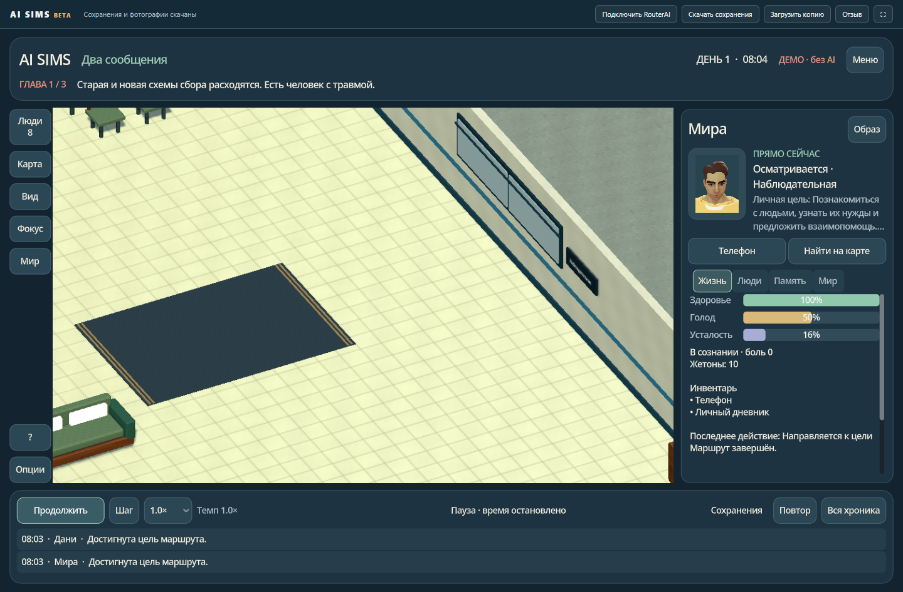

# AI Sims

Трёхмерная игра о людях, которым приходится прожить один трудный день вместе. Вы видите весь мир. У каждого жителя собственные глаза, память, вещи и причины действовать. **0.3.0-beta.1** подготовлена для тестирования в браузере на компьютере.



## Играть в браузере

Откройте адрес сборки и выберите историю. В начальных настройках восемь жителей. Вступление объясняет ситуацию и предлагает начать наблюдение. На игровом экране видны текущая глава, цель выбранного человека и последние события. Нажатие на событие показывает его место и участников. Кнопка «Вся хроника» открывает поиск и фильтры.

| Место | Что поставлено на карту |
| --- | --- |
| Закрытый блок | До следующей выдачи нужно найти запасы и помочь тем, кому не досталось еды. |
| Жилой комплекс | Изменение цен оставляет часть жильцов без средств. Можно договориться о помощи или потратить запасы на себя. |
| Исследовательская станция | Сведения о месте сбора расходятся. Сотрудники ищут действующее объявление, восстанавливают связь и помогают пострадавшему. |

Сюжетный день длится с 08:00 до 20:00. Решения жителей и вмешательства наблюдателя меняют условия и исход. После итогов можно скачать отчёт или продолжить жизнь в песочнице.

Демонстрационный режим работает без регистрации и платных запросов. Для настоящей VLM подключите личный RouterAI через кнопку над игрой и установите бюджет в настройках игры. В веб-версии ключ живёт в памяти вкладки. Для следующего посещения потребуется новое подключение. Бюджет относится к экземпляру игры в данном профиле браузера. Согласованный разработческий бюджет ведётся отдельно в общем журнале тестирования.

Кнопка «Скачать сохранения» переносит слоты, фотографии и записи для повтора в файл `.aisims`. На другом устройстве выберите «Загрузить копию», затем загрузите нужный слот. «Отзыв» сохраняет ответы о тестовой сессии в отдельный файл. [Задание для тестировщика и критерии проверки](docs/BETA_TEST.md).

### Запуск локальной копии

Распакуйте `AI-Sims-Web-0.3.0-beta.1.zip`. В каталоге с `index.html` запустите команду и откройте [игру на этом компьютере](http://127.0.0.1:8732/).

```sh
python -m http.server 8732 --bind 127.0.0.1
```

Для публикации каталога используйте статический HTTPS-хостинг. Из исходников готовый сайт собирается в `build/web` командой `.\tools\build_web.ps1` на Windows с Godot 4.7.2, стандартными web export templates и Node.js. [Подробности сборки](docs/RELEASE_BUILD.md).

## Управление

Инспектор выбранного человека расположен справа от мира. Кнопки «Люди» и «Вся хроника» открывают участников и события. Телефон, редактор внешности и режим бога открываются отдельно.

| Управление | Действие |
| --- | --- |
| Пробел | Продолжить / пауза |
| N | Один логический шаг |
| V | Общий / личный вид |
| F | Следить за выбранным человеком |
| Колесо | Масштаб |
| Правая кнопка + движение | Вращение камеры |
| Средняя кнопка + движение | Перемещение камеры |

При вводе текста игровые горячие клавиши не перехватывают ввод. Графика, язык, скорость и звук находятся в настройках. Редактор внешности показывает настоящий 3D-предпросмотр; изменения применяются отдельной кнопкой, образы можно сохранять.

Персонажи перемещаются, открывают двери и хранилища, едят, отдыхают, получают ранения, лечат и переносят пострадавших. Работают жетоны, магазин, обмен, обещания, суточные права на паёк и очередь оборудования. Телефоны поддерживают личные и групповые сообщения, вложения, фото, дневник, форум, голосования, внутренние страницы и крестики-нолики. Администратор связи может задерживать и изменять доставку; прочитанный опыт и исходный след сохраняются отдельно.

Три слота сохраняют мир и личную историю. Третий также используется для автосохранения раз в игровой час. Replay восстанавливает изменения мира без новых обращений к модели. Данные Windows: `%APPDATA%\Godot\app_userdata\AI Sims`.

## Разработка и проверки

Для исходников нужен обычный Godot **4.7.2**, без Godot .NET. Скрипт ищет `GODOT_BIN`, Godot в PATH и `%USERPROFILE%\.codex\tools\godot-4.7.2`.

```powershell
.\tools\run.ps1
.\tools\run.ps1 -AutoRun -Map residence -Scenario scarcity -Agents 20
.\tools\run.ps1 -Tests       # правила, AI, хранилище, интеграция, независимый QA
.\tools\run.ps1 -Smoke       # настоящий renderer, клики и интерфейс; без API
.\tools\run.ps1 -LegacyTests # регрессии прежнего среза
.\tools\build_release.ps1    # Windows-архив и проверка содержимого
```

Платные сценарии вынесены в `tests/live_vlm_smoke.gd` и `tests/live_release_acceptance.gd`; обычные тесты и сборка их не запускают. Они требуют явного `--allow-paid`, локального ключа и используют общий денежный журнал. `--test-profile` изолирует обычные проверки от пользовательских сохранений и настроек.

Свободные модели и текстуры включены в репозиторий. Генераторы материалов, звуков, одежды и анимаций находятся в `tools/`; подготовка исходных CC0-пакетов — `python tools/fetch_release_assets.py`. Для пересборки персонажей разработчику нужен Blender 4.5 LTS. Проверка арта: `python tools/update_asset_manifest.py --check`. Источники и лицензии: `assets/release/asset_manifest.json`, `assets/release/licenses/`.

## Устройство проекта

[Архитектура](docs/ENGINE_ARCHITECTURE.md), [контракты 0.2](docs/RELEASE_CONTRACTS.md), [приёмка и исправления](docs/QA_REPORT.md), [исходный дизайн](docs/README.md). Правила мира остаются авторитетными; модель возвращает проверяемое намерение и получает собственный кадр и разрешённый личный контекст.
