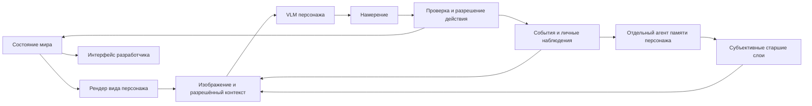

# Архитектура и выбор движка

Статус: исследование, решение открыто. Обязательное зрение через VLM существенно влияет на сравнение: изображение теперь является входом механики, а не только способом показать результат зрителю.

Последнее рабочее направление автора: один 3D-мир, камера зрителя сверху под углом, перспективный вид из глаз и движение по поверхностям этажей. Разобрано в [мире и внешности](09-world-and-appearance.md). Для него основной кандидат — готовый 3D-renderer; чисто плоское представление больше не является главным предложением.

## Два отдельных выбора

Нужно решить, где живут правила симуляции и чем создаётся изображение мира. Собственное ядро правил может работать внутри Godot либо отдельно от него. Полностью собственный графический движок — существенно более широкий проект.

| Вариант | Выгода | Цена и неопределённость | Когда проверять |
| --- | --- | --- | --- |
| Godot, правила отделены от сцен и анимации | Готовые мир, камеры, перекрытия, редактор, capture и упаковка в одном проекте | Свои журнал, знания, проверка действий, время и replay всё равно нужны | Цель — визуальная демка с настоящим восприятием |
| Godot + отдельное ядро | Независимые правила и эксперименты, Godot создаёт виды агентов и интерфейс | Протокол, синхронизация состояния и кадров, два процесса, поставка | Независимое ядро даёт подтверждённую пользу |
| Собственное ядро + web-интерфейс и готовый renderer | Удобные таблицы, журнал и анализ, выбор web-стека | Также нужны камеры, преграды, игровое пространство и экспорт кадров | Предпочтителен браузер и есть опыт соответствующего стека |
| Полностью собственный графический движок | Контроль над специализированными требованиями | Рендеринг, редактор, ввод, ресурсы, зрение и инструменты становятся нашей задачей | Только если эксперимент выявит ограничение готовых решений |

Оценка в таблице — инженерное суждение, не результат бенчмарка. Выбор «свой renderer» и выбор «свои правила» нельзя смешивать.

## Предлагаемая общая граница ответственности

Рендер получает позу персонажа и состояние мира в определённый момент. Агент получает только свой кадр и доступные ему сведения. Память и социальный граф принадлежат персонажам; отладчик может читать полное состояние. Визуальная анимация не должна самостоятельно выдавать предмет или завершать договор.

Телесное состояние участвует в фильтрации восприятия и проверке действий. Слепому не передаётся текущая сцена; сломанные руки запрещают заданные автором действия; нога меняет параметры движения/усталости. Проверка повторяется при исполнении, поскольку тело могло измениться во время запроса VLM. Модель и роль агента сохраняются. См. [тело и возможности](16-body-and-capabilities.md).

По решению автора полный доступ к игровой информации есть и у игрока-наблюдателя. Его интерфейс читает истину и все личные версии без изменения наблюдений агентов. Стартовая инициализация мира и знаний участников разделены; раскрытие ролей и стирание памяти задаются сценарием. См. [старт и наблюдателя](14-scenario-start-and-observer.md).

По уточнению автора автоматическую память ведёт отдельный агент. Он получает только личный опыт и профиль данного персонажа; недавний контекст не переписывает, а старые версии последовательно сокращает. Дневник и фотографию создаёт только добровольное игровое действие. Контракты и правила применения версий — в [памяти](10-memory-and-notes.md), носители — в [артефактах](11-diary-and-photographs.md).

Характер задаётся отдельным устойчивым профилем, из которого формируется личностная часть системного prompt. Неизменный фундамент защищён от обновления. При суммаризации памяти агент может принять решение об ограниченном изменении вторичных черт по личному опыту; система проверяет и применяет предложенные изменения. Интервалы между возможностями пересмотра задаются в пределах 1–60 игровых дней со средним 30 в обычных условиях. Сам характер может не меняться дольше 60 дней. Точное распределение и временной алгоритм ещё не выбраны.

Жизненные устремления входят в фундамент, текущие задачи и планы персонаж формирует и пересматривает сам. Память, состояние и текущие намерения предлагается передавать отдельными логическими блоками. Версии характера и памяти фиксируются для каждого запроса; рекомендуется согласованно применять их обновления, не изменяя контекст уже отправленного решения. Конкретный формат хранения не выбран.

Один цикл для семи персонажей может потребовать до семи отдельных заданий памяти на обрабатываемый уровень, дополнительно к запросам решений. Это пример схемы, не обещание количества фактических вызовов: нужны интервалы, лимиты входа/выхода и измерение отставания. Общая модель может обслуживать разные роли, но контексты не объединяются.

## Что подтверждено для Godot

- Есть запуск без окна и dedicated server export. Но `--headless` отключает отрисовку; `RenderingServer` в таком режиме возвращает заглушки. Headless полезен для проверок правил и replay записей, но не даёт новых изображений для VLM. [Dedicated server](https://docs.godotengine.org/en/stable/tutorials/export/exporting_for_dedicated_servers.html), [RenderingServer](https://docs.godotengine.org/en/stable/classes/class_renderingserver.html).
- `SubViewport` создаёт отдельную текстуру без отдельного окна; кадр можно получить через `get_texture().get_image()` после завершения рендеринга. Это требует работающего renderer. Проверка скрытого/свёрнутого запуска на конкретной Windows/GPU остаётся техническим экспериментом. [SubViewport](https://docs.godotengine.org/en/stable/classes/class_subviewport.html), [захват кадра](https://docs.godotengine.org/en/stable/tutorials/rendering/viewports.html#capture), [Window](https://docs.godotengine.org/en/stable/classes/class_window.html).
- `Camera3D` имеет FOV, clipping planes и маску слоёв. Попадание во фрустум не доказывает видимость сквозь препятствия; `far` не равен сферическому радиусу зрения. Для вида сверху в 2D нужна явная маска сектора и преград. [Camera3D](https://docs.godotengine.org/en/stable/classes/class_camera3d.html).
- Для 2D существует `canvas_cull_mask`, но дочерние `CanvasItem` не наследуют visibility layers родителей. Исключение debug-интерфейса из кадров нужно проверять на фактически отправленных изображениях. [Viewport](https://docs.godotengine.org/en/stable/classes/class_viewport.html#class-viewport-property-canvas-cull-mask).
- Есть кадровый и фиксированный физический циклы. Физика Godot при этом не гарантирует детерминированность. Шаг правил предлагается отделить от FPS; фиксированного timestep недостаточно для replay. [Циклы](https://docs.godotengine.org/en/stable/tutorials/scripting/idle_and_physics_processing.html), [физика](https://docs.godotengine.org/en/stable/tutorials/physics/physics_introduction.html).
- Пауза дерева сцен не блокирует сигналы. Ответ VLM должен попадать в очередь и применяться контролируемым шагом, с проверкой актуальности запуска. [Пауза](https://docs.godotengine.org/en/stable/tutorials/scripting/pausing_games.html).
- Есть HTTP и WebSocket. Один экземпляр `HTTPRequest` нельзя использовать для нескольких одновременных запросов; его timeout измеряется реальным временем независимо от `Engine.time_scale`. [HTTPRequest](https://docs.godotengine.org/en/stable/classes/class_httprequest.html), [WebSocket](https://docs.godotengine.org/en/stable/tutorials/networking/websocket.html).
- Если потребуется браузерная поставка, по текущей stable-документации Godot 4 C# не поддерживает web export. Это ограничение конкретной комбинации, а не всего Godot. [Web export](https://docs.godotengine.org/en/stable/tutorials/export/exporting_for_web.html).

Для web-варианта необязательно писать renderer с нуля: Three.js предоставляет render targets и чтение пикселей. Но создание мира, ограниченных видов агентов и синхронизация с правилами остаются работой проекта. [Render targets](https://threejs.org/manual/pages/rendertargets.html), [WebGLRenderer](https://threejs.org/docs/pages/WebGLRenderer).

## Устройства и внутриигровая сеть

Телефон, аккаунт, локальное хранилище, сетевой сервис и реестр выдачи предлагается моделировать отдельно в правилах мира. Доставка и подмена создают разные личные наблюдения; память не читает серверный оригинал вместо полученной версии. Это симулируемые услуги, не интеграция с реальными мессенджерами.

Для демки выбраны автоматический терминал и контроль сети, включая удаление/подмену. Общая версия мира должна фиксировать выдачу, состояние сообщения и полномочия; интерфейс показывает только доступную персонажу версию. Граница между редактированием уведомления и управлением настоящим реестром пока предлагается, не утверждена. Детали — в [распределении](12-possession-and-distribution.md) и [сети](13-devices-and-network.md).

## Движение в предложенном объёмном мире

Для движения в Godot доступны `NavigationRegion3D`, `NavigationAgent3D` и `CharacterBody3D`. Навигация выдаёт путь, но физическое перемещение исполняет наш код. `NavigationLink3D` соединяет маршруты, не создавая механику лестницы или лифта. Доступ к глобальному navmesh требует ограничения, чтобы автопилот не проводил персонажа через неизвестную карту. [NavigationRegion3D](https://docs.godotengine.org/en/stable/classes/class_navigationregion3d.html), [NavigationAgents](https://docs.godotengine.org/en/stable/tutorials/navigation/navigation_using_navigationagents.html), [NavigationLinks](https://docs.godotengine.org/en/stable/tutorials/navigation/navigation_using_navigationlinks.html), [CharacterBody3D](https://docs.godotengine.org/en/stable/classes/class_characterbody3d.html).

## Время и асинхронные решения

Пока открыто, ждёт ли мир ответов VLM. Для первого сравнения предлагается контролируемый раунд: зафиксировать момент наблюдения, собрать намерения, разрешить конфликты, применить изменения, продвинуть время. Это облегчает объяснение результата, но требует решения автора о желаемом ощущении темпа.

У запроса должны быть идентификаторы запуска, персонажа, шага и наблюдения. Ответ после reset, загрузки или устаревания ситуации нельзя применять без повторной проверки. При непрерывном времени нужны правила устаревания и перерасчёта действия. При паузе сетевой запрос может завершиться, но сам по себе не двигает мир.

Предлагается отдельно определить timeout, предел повторов и безопасное действие при ошибке — например, ожидание. Условия, где ожидание приводит к гибели, требуют особенно ясной семантики времени; сетевую ошибку нельзя молча выдавать за осознанный поступок персонажа.

## Запись и воспроизведение

Сохранять исходное состояние, версии правил/ресурсов/renderer, параметры и байты отправленных изображений, разрешённый контекст, ответы модели, проверенные действия, порядок событий, случайные результаты и вмешательства.

Replay читает запись без генерации новых решений. Повторный рендер может отличаться из-за ресурсов, версии движка и драйвера, поэтому исходные кадры должны оставаться доступны. Seed не гарантирует идентичный VLM-ответ; у Godot даже алгоритм RNG считается деталью реализации. [RandomNumberGenerator](https://docs.godotengine.org/en/stable/classes/class_randomnumbergenerator.html).

## Технический эксперимент после согласования

Одна сцена: персонаж, предмет, стена, дверь, поворот взгляда. Затем два агента с разными видами и один ограниченный ресурс; итоговая нагрузочная проверка — до семи. Начать с записанных действий, затем подключить реальную VLM.

Сравнить кандидатов по одинаковым критериям:

1. Получается ли правильный кадр каждого агента без скрытой информации?
2. Можно ли остановить мир, сделать один шаг и объяснить каждый результат?
3. Каковы расходы рендера, чтения пикселей, кодирования, сети и VLM по отдельности?
4. Как обрабатываются медленный ответ, неверная команда, reset и повтор ответа?
5. Воспроизводятся ли правила и история из записи?
6. Как запускается собранная демка на целевой машине; сколько процессов и ручных шагов требуется?

Не разрабатывать четыре полных прототипа. После ответов автора выбрать одного основного кандидата и при необходимости минимальный альтернативный пример для спорного требования.

## Предварительное мнение

С обязательным зрением **Godot с изолированными правилами становится сильным первым кандидатом**. Он уже решает камеры, пространственную сцену и получение изображений. Если независимый симулятор нужен для исследований или предпочтительного стека, возможен Godot как renderer плюс отдельное ядро. Оснований строить собственный графический движок пока не обнаружено.

Это рекомендация для обсуждения, не утверждённая архитектура. До выбора нужны подтверждение предложенной связки камер, целевая платформа, правило времени и предпочтения автора по разработке. Модель по умолчанию уже выбрана: RouterAI, `~deepseek/deepseek-v4-flash-latest`; интеграция ещё не проверена реальным запросом.
