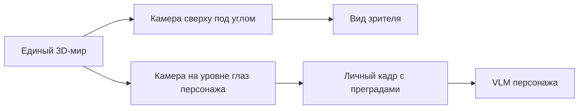

# Объёмный мир, камеры и внешность

Обновлено: 1 ноября 2026. Автор предложил вид сцены 2.5D сверху, перемещение по горизонтальным поверхностям и полноценный трёхмерный вид из глаз. Ниже — рекомендуемое уточнение этой схемы. Кастомизируемая внешность обязательна по прямому требованию автора; глубина редактора ещё не согласована.

## Рекомендуемая схема мира

Один трёхмерный мир содержит геометрию помещений, предметов и тел. Зритель смотрит сверху под углом через ортографическую либо перспективную камеру. Персонаж видит этот же мир из глаз через собственную перспективную камеру с ограниченным полем зрения.

«2.5D» здесь описывает подачу зрителю и ограничения движения. Исходная сцена остаётся 3D. Не требуется строить отдельную плоскую версию мира и затем восстанавливать из неё объёмное изображение для агента.

**Пример:** зритель видит шкаф и область за ним благодаря своему ракурсу. Персонаж перед шкафом не видит предмет за ним. Чтобы получить новое знание, ему нужно изменить положение или направление взгляда. Возможности верхней камеры не переходят агенту.

## Движение и высота

Для терминологии Godot горизонтальная плоскость — XZ, высота — Y. Персонаж ходит по доступной поверхности этажа. На полу его высота определяется поверхностью, на лестнице меняется вдоль подъёма, в лифте — движением платформы. Постоянная высота для всего мира сломает этажи и переходы.

Объекты могут находиться на полу, столе, полке, стене и потолке. Видеть объект и иметь возможность дотянуться до него — разные условия. Поднять предмет сверху, открыть нижний ящик и посмотреть поверх шкафа требуют разных проверок.

Предложение: разрешить поворот взгляда по горизонтали и вертикали, ограничив свободное перемещение тела поверхностями. Лестницы, лифты, прыжки и карабканье — отдельные возможности, из ограничения ходьбы они автоматически не следуют.

Маршрутизатор не должен раскрывать неизвестную карту. Предлагаемая граница: моторный исполнитель доводит до доступной локальной цели, а выбор неизвестных проходов опирается на знания персонажа. Всеведущий маршрут до скрытого выхода разрушит механику исследования, даже если его не нарисовать в кадре.

Для будущего лифта недостаточно соединить точки маршрута: нужны ожидание, вызов, положение кабины, вместимость и посадка. Для первой демки предлагается один этаж; лестницу добавить только если она нужна для проверки выбранной механики. Это рекомендация по объёму, не запрет автора.

## Разные права камер

Для обзора зрителя можно скрывать крышу и часть стен, добавлять подписи и выделение персонажа. Такие изменения должны действовать только на зрительский вид. Стена продолжает закрывать обзор агента и препятствовать движению; скрытые предметы не подсвечиваются в его кадре.

Автор определил полный доступ наблюдателя ко всей игровой информации. Верхняя камера и вид из глаз — переключаемые представления; игрок может в любой момент открыть истину и личные данные любого участника. Само переключение вида не раскрывает персонажам сведения из панелей игрока.

В Godot `Camera3D` поддерживает ортографическую/перспективную проекцию и `cull_mask`; отдельные `SubViewport` позволяют получать разные виды одного `World3D`. Это техническая основа предлагаемой схемы. [Camera3D](https://docs.godotengine.org/en/stable/classes/class_camera3d.html), [SubViewport](https://docs.godotengine.org/en/stable/classes/class_subviewport.html), [Viewport](https://docs.godotengine.org/en/stable/classes/class_viewport.html).

## Внешность как обязательная механика

Автор прямо требует внешность с кастомизацией по типу The Sims, поскольку она должна участвовать в субъективном восприятии и отношениях. Это часть игрового замысла, а не только декоративное оформление.

Нужно разделить три слоя:

| Слой | Что содержит | Кто имеет доступ |
| --- | --- | --- |
| Реальная внешность | Геометрия тела/лица, волосы, одежда и аксессуары | Мир и редактор; персонаж видит доступные части через изображение |
| Увиденный образ | Какие черты удалось заметить с данного ракурса и расстояния | Личная память наблюдателя |
| Субъективное впечатление | Симпатия, знакомость, предположение о роли, привлекательность или настороженность | Конкретный наблюдатель, с возможностью ошибки |

Скрытые черты характера, намерения и биография не читаются из внешности как достоверный факт. Персонаж может делать предположения, а затем менять их по поступкам.

**Пример:** одному персонажу строгая форма кажется признаком компетентности, другому напоминает неприятный опыт. Позднее помощь или обман меняют их отношения. Это гипотеза поведения, которую нужно проверить; один и тот же VLM-backend сам по себе не обеспечивает разные вкусы.

Предложение: не вводить единую объективную «красоту» с одинаковым бонусом ко всем отношениям. Впечатление складывать из воспринимаемых черт, личных предпочтений, контекста и опыта общения. Степень влияния внешности пока открыта.

## Кастомизация: первый объём и расширение

Для демки предлагается компактный конструктор, позволяющий создать до семи визуально различимых персонажей:

- несколько вариантов лица и причёски;
- ограниченные параметры телосложения и роста;
- цветовые варианты кожи, волос и одежды;
- несколько комплектов одежды и заметных аксессуаров.

Это предлагаемый минимум для проверки различимости и первых впечатлений. Полный набор возможностей редактора The Sims, создание одежды пользователем и смена внешности во время жизни пока не обещаны. Конкретные диапазоны и стиль требуют решения автора.

Данные кастомизации должны менять реальную видимую модель. Текст «у него шрам» без соответствующего элемента в изображении не доказывает визуальную механику. Напротив, закрытая одеждой черта не должна раскрываться в чужом контексте.

Разная высота меняет уровень глаз и обзор. Разное телосложение требует согласованных размеров тела и столкновений. Габариты, графика и правила досягаемости не должны расходиться без явного игрового решения.

## Узнавание и память о человеке

Внутренний ID тела нужен движку, но не должен автоматически сообщать агенту личность незнакомца. Узнавание опирается на доступные виды, запомненные приметы, представление собеседника и контекст. Возможны сомнение и ошибочное сопоставление.

Портрет из редактора нельзя автоматически выдавать всем персонажам как личное воспоминание. Если наблюдатель видел человека только со спины, его память не содержит точного фронтального лица. Кадр или crop можно запомнить только из законно доступного изображения.

Смена одежды не меняет истинную личность, но может повлиять на узнавание. Если такая механика появится, отдельно определить роль лица, голоса, привычек и знакомства. Голосовая идентификация пока не разработана.

Автор ввёл фотографию как отдельный точный артефакт: она может сохранить увиденный портрет дольше внутренней памяти. Персонаж получает точное изображение при доступном просмотре снимка, а его память о нём по-прежнему суммаризируется и искажается. Возможность постоянного внутреннего альбома отдельно не принята. Скрытый безошибочный распознаватель лиц не добавляется автоматически.

## Проверки для демки

1. Один предмет на полу, второй на полке: различимы видимость и досягаемость.
2. Скрытие стены у зрителя не раскрывает её содержимое агенту.
3. Изменение причёски/одежды в конструкторе видно в кадре другого персонажа.
4. Агент узнаёт знакомого по доступным приметам, а не по служебному ID.
5. Два разных профиля формируют разные первые впечатления об одном видимом образе; поступки способны изменить их.
6. При старении воспоминания подробности внешности теряются согласно выбранным правилам, без обращения к портрету разработчика.

## Предварительное влияние на выбор движка

Предложенная схема усиливает рекомендацию проверить Godot: требуются готовые 3D-сцена, несколько камер, персонажи и настройка внешности. Собственные правила, память, узнавание и отношения всё равно нужно проектировать. Движок остаётся открытым решением.
