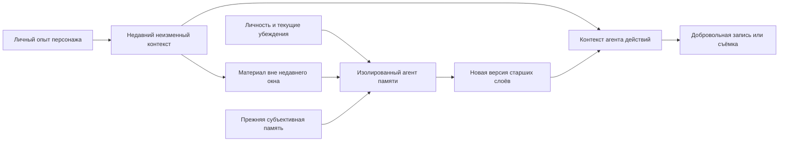

# Память, забывание и собственные записи

Обновлено: 2 ноября 2026. Автор уточнил направление: память формируется автоматически отдельным агентом; недавний контекст сохраняется неизменным, более старый постепенно суммаризируется, отражает личность и может накапливать ошибки. Дневник и точная фотография — отдельные добровольные действия и артефакты. Ниже — игровая модель, а не утверждение о научной достоверности человеческой памяти.

Дополнительное решение автора: ошибки возникают только при субъективном сокращении и переосмыслении. Отдельный механизм специального внесения ложных деталей не вводится. Если сжатие в конкретном случае не ошиблось, не нужно создавать ошибку ради драматического результата.

## Три независимых механизма

| Механизм | Кто создаёт | Что сохраняет | Что происходит со временем |
| --- | --- | --- | --- |
| Память | Автоматический агент памяти | Личный опыт и его субъективную переработку | Старые слои сжимаются, теряют детали и могут искажаться |
| Дневник | Сам персонаж по собственному решению | Очень краткую запись выбранных событий/мыслей | Запись остаётся в носителе; изменения требуют отдельного действия |
| Фотография | Персонаж действием съёмки | Точное изображение доступного вида в момент исполнения съёмки | Содержимое сохраняется, судьба экземпляра определяется правилами предмета |

Фотография и дневник не являются скрытыми слоями автоматической памяти. Вспомнить снимок и снова рассмотреть доступный экземпляр — разные способы получить сведения. Подробные механики: [дневник и фотографии](11-diary-and-photographs.md).

## Рекомендуемая слоистая память

| Слой | Что доступно персонажу | Как меняется со временем |
| --- | --- | --- |
| Недавний неизменный контекст | Собственные кадры, доступная речь, выполненные действия и уже сформированные восприятия | До выхода из недавнего окна не суммаризируется и не переписывается; допустимо добавление новых наблюдений |
| Краткая память об эпизодах | Избранные кадры, crop, собственные описания и важные детали | Уменьшаются число образов, разрешение, точность деталей; часть записей переходит в текст |
| Долгая смысловая память | События, приметы, обещания, сведения о местах и выводы | Детали могут теряться, выводы пересматриваются, сохраняется происхождение доступных сведений |

Схемы могут быть реконструкцией из смысловой памяти либо отдельным артефактом. Дневник и фотографии хранятся по правилам носителей, а не переходят автоматически между слоями памяти.

Длительность недавнего окна и интервалы консолидации ещё не выбраны. Рекомендуется игровое время: на паузе сетевая задержка сама по себе не должна съедать зрительный буфер. Отправленное наблюдение фиксируется на момент запроса. Неизменность свежих данных не означает безошибочного первоначального распознавания VLM.

Глубина памяти и бюджет имеют ограничения: на число кадров, их размер, объём текста и количество заметок. Семь персонажей с бесконечным буфером всё равно создадут растущую историю. Конкретные лимиты выбираем после замеров.

## Отдельный агент памяти

Автор требует отделить автоматическое формирование памяти от агента, выбирающего игровые действия. Предлагается общий сервис с отдельными изолированными заданиями для каждого персонажа. Для семи персонажей не требуется семь загруженных копий модели, но их входы, история и результаты не смешиваются. Отдельный агент означает роль и контекст, а не обязательную другую модель. Default проекта остаётся RouterAI `~deepseek/deepseek-v4-flash-latest`; специализированная замена для памяти не выбрана, мультимодальный вход нужен при прямом анализе кадров.

Вход задания: прежняя доступная память этого персонажа, его личный опыт за выбранный интервал, собственный профиль, актуальные подозрения/убеждения и версия памяти. Не передавать объективную историю мира, чужую память и закрытый архив разработчика.

Профиль характера задаёт личностную часть системного prompt, имеет неизменный фундамент и вторичные черты. При суммаризации памяти агент также решает, нужно ли сейчас изменить вторичные черты на основании личного опыта. Он может сохранить профиль или предложить небольшое добавление/удаление; фундамент не редактируется. Возможности пересмотра разделяются вероятностными интервалами 1–60 игровых дней со средним 30 в обычных условиях. Изменение не обязательно, характер может сохраняться и дольше 60 дней. Точное распределение и влияние событий ещё уточняются. Подробности — [M-04](02-mechanics.md).

Выход: новая версия разрешённых к сокращению слоёв, сохранённые/потерянные детали, субъективные трактовки, текущие представления о людях и записи причин преобразования для наблюдателя/разработчика. Дополнительно — решение о сохранении характера либо ограниченные изменения вторичных черт с основаниями. Они проверяются и применяются системой отдельно от свободного текста памяти. Агент памяти не выполняет игровые действия, не пишет дневник и не создаёт фотографии.

Телесные ограничения действуют и на опыт, который поступает в память. После слепоты новые зрительные кадры и содержимое недоступных экранов не добавляются. Предлагается сохранять законно полученные прежние визуальные воспоминания по обычным правилам старения; слепота сама по себе не стирает историю. Точный архив наблюдателя не заменяет отсутствующее восприятие. См. [тело и возможности](16-body-and-capabilities.md).

Предлагаемый цикл на границе игрового интервала:

1. Зафиксировать версию личного опыта до определённого игрового времени.
2. Сохранить недавнее окно без изменений; выделить данные, вышедшие за его пределы.
3. Для каждого персонажа отдельно сформировать субъективные эпизоды и при необходимости сократить более старые слои.
4. Проверить владельца, границы изменяемых данных, объём, ссылки и допустимость доступа; для изменения характера — допустимые вторичные черты и неизменность фундамента. Проверка формата не исправляет личные убеждения по объективной истине.
5. Применить новую версию в определённой точке симуляции. Запрос действия, уже получивший старую версию, не менять задним числом.
6. Записать вход, выход и причины изменений в закрытый trace. Новые наблюдения, пришедшие во время расчёта, сохранить отдельно до следующей обработки.

Периодическая проверка предусмотрена для всех персонажей. Порядок выполнения, ожидание результатов и возможность явного no-op без лишнего вызова модели при отсутствии изменений — инженерные предложения, требующие проверки. Ошибка/опоздание задания оставляет последнюю валидную версию и новые наблюдения, не удаляя данные молча.

## Каскадное сокращение

Предложение: несколько возрастных уровней вместо полного переписывания всей жизни каждый такт. Когда эпизод стареет, его текущая версия объединяется с соседними и сокращается. Следующая свёртка работает с уже субъективным результатом: так возможны накопление ошибок и усиление прежнего подозрения.

Архив исходных кадров не используется для автоматического восстановления точности. Иначе персонаж будет каждый раз получать исправленное прошлое. Недавнее окно сохраняется буквально, а для отдельных старших уровней определяются объём, период перехода и правила приоритета.

Накопление ошибок допускается только как результат субъективной свёртки. Предложение: различать потерю детали, неточную деталь, смещение значимости и ошибочный вывод. Не вводить отдельную случайную порчу или поручение придумать ложное событие. Проверять фактические ошибки; потеря свежих записей, чужой владелец и невалидные ссылки остаются техническими сбоями.

## Личность и субъективность

Автор предлагает лучшую сохранность деталей при высоком интеллекте и влияние подозрений на память. Рекомендуется оформить это как настраиваемые игровые правила: интеллект влияет на бюджет/точность сохранения нюансов; внимание — на выбор подробностей; текущие убеждения — на значимость и трактовку; стресс и усталость можно добавить после базовой проверки.

Интеллект не выдаёт скрытые факты и не гарантирует правильность вывода. Подозрительный персонаж с хорошей памятью может помнить больше подробностей и всё же неверно их объяснять.

**Пример:** в недавнем контексте остаётся кадр человека у шкафа. Поздняя память одного наблюдателя — «он, кажется, что-то искал», другого — «он снова крутился возле запасов». При следующем сокращении подозрение может закрепиться как уверенность. Это изменение личного воспоминания, а не факта мира.

## Что именно означает «размывание»

Предложение: считать это потерей подробностей, а не одним графическим фильтром.

- Стареющий эпизод теряет часть второстепенных кадров.
- Остаются значимые виды, отдельные детали или менее подробные изображения.
- Текст сохраняет запомненный смысл, источник и степень уверенности.
- Самые старые исходные кадры перестают быть доступны персонажу согласно согласованной политике.

Визуальный blur можно проверить как один способ потери деталей. Но размытый файл той же размерности остаётся входным изображением; экономию стоимости или визуальных токенов нужно измерить, а не предполагать. Для экономии важны также количество, размер и частота отправки изображений.

При выборе ключевых кадров использовать только собственный визуальный поток. Скрытое мировое событие не должно само по себе внезапно давать агенту «особенно важный» кадр или подсказку о том, чего он не мог видеть.

Новое решение персонажа получает неизменный недавний блок и текущую субъективную память; релевантная выборка относится к более старым слоям. Длину окна и исходную частоту наблюдений нужно подобрать так, чтобы недавний блок помещался в бюджет без скрытой суммаризации. Все кадры анимации renderer не обязаны становиться опытом агента, но уже полученные им недавние данные нельзя переписать ради лимита. Дополнительное извлечение касается доступных старых воспоминаний.

## Три разных действия с памятью

| Действие | Что делает | Чего не гарантирует |
| --- | --- | --- |
| Вспомнить | Извлекает сохранившуюся запись или образ | Не восстанавливает уже удалённые детали |
| Осмыслить/повторить | Сопоставляет доступные воспоминания, создаёт вывод или выбирает, что удержать | Не превращает повторение в новое зрительное доказательство |
| Проверить/освежить наблюдением | Повернуться, вернуться в место, посмотреть на человека, перечитать доступную записку | Не подтверждает автоматически старую интерпретацию |

Если повторение продлевает удержание воспоминания, это отдельное правило. Даже тогда время исходного события не сбрасывается. Повторно нарисованная по тексту карта не становится точной копией когда-то увиденного мира. Для точного устойчивого изображения вводится добровольная фотография; она не создаётся автоматически при вспоминании.

Предложение: активное запоминание и составление схем занимают игровое время/внимание; объём затрат не выбран. Автоматический технический отбор и запись кадра в буфер не равны осознанному созданию заметки.

## Достоверность и происхождение

Различать два уровня: настоящее происхождение данных в закрытом журнале разработчика и происхождение, которое вспоминает персонаж. Журнал сохраняет, было ли это зрение, сообщение, предыстория или вывод. Субъективная память может путать детали и при согласованных правилах даже источник, не получая доступа к истине из журнала.

**Пример:** «видел человека в синей куртке у шкафа» при повторных свёртках может ошибочно превратиться в «помню, Иван забрал еду». Разработчик видит цепочку искажения; мир не получает нового события кражи. Такое ложное воспоминание не считается подтверждённым знанием.

Предложение для технических метаданных: настоящее время наблюдения и преобразования, владелец, реальный канал/источник, ссылки и версии. Отдельно хранить вспоминаемое время/источник и субъективную уверенность. Точные технические поля не возвращаются персонажу как незаметное исправление. Если изображение удалено из доступной памяти, ссылка не открывает закрытый архив.

Самооценка уверенности модели не является гарантией точности. Возможность накопления ошибок субъективного сокращения задана автором; их частоту и характер нужно измерить. Ошибка не должна превращаться в доступ к реальному скрытому событию или в повреждение авторитетного состояния мира.

## Субъективная карта

Агент может хранить схему посещённых мест, предполагаемых соединений и замеченных ориентиров. Предложение: основа схемы — ограниченный граф комнат/проходов с примерными взаимными положениями, заметками и отметкой неопределённости. Его можно визуализировать как рисунок.

Такая карта может быть неполной, устаревшей или ошибочной. Неисследованная дверь остаётся неизвестной; рассказ другого персонажа отмечается как чужое сообщение. Движок не исправляет схему по настоящему плану комплекса.

Долгая смысловая запись карты может быть текстом/структурированным графом. Сгенерированная из неё картинка — новый вид текущего знания, а не сохранившийся древний кадр. Это позволяет обсудить схемы, сохранив правило «старые зрительные кадры заменяются смыслом».

## Как текстовая VLM может рисовать

Выбранный alias заявляет текстовый выход, поэтому создание изображения схемы требует инструмента. Предложение: VLM описывает узлы, линии, подписи и грубые формы через ограниченные команды; инструмент рисует их на личном холсте. Можно также обрезать и подписывать ещё доступный собственный кадр. Поддержку выбранного формата команд предстоит проверить. [Метаданные RouterAI](https://routerai.ru/api/v1/models).

Инструмент исполняет введённые примитивы и не подставляет реальные стены, лица или предметы из базы мира. Он не получает скрытую карту. Рисунок не выдаёт себя за новое наблюдение.

Для внешности сначала разумно проверить доступный crop/кадр и текст примет. Создание узнаваемого портрета по набору графических примитивов — отдельный эксперимент, а не гарантированная возможность VLM с текстовым выходом.

## Личная память и материальная запись

Это разные механики, требующие выбора:

- **Личный образ/мысленная схема:** доступен владельцу через память и подчиняется её ограничениям.
- **Материальная записка, карта или рисунок:** находится в мире; её можно увидеть, перечитать, передать, потерять или украсть согласно отдельным правилам.

Автор добавил дневник и фотографию как отдельные добровольные механики. Фотография явно является артефактом, допускающим передачу, продажу, шантаж, потерю и уничтожение. Форму дневника и доступ к нему ещё нужно уточнить. Все персонажи не получают содержимое записи автоматически. См. [механику артефактов](11-diary-and-photographs.md).

Внутреннюю цифровую заметку с вечным точным изображением нельзя незаметно добавить как обход забывания. Если такие личные записи нужны, их ёмкость и сохранность согласовать явно.

## Память внешности

Различать истинного человека, увиденные приметы и гипотезу о личности. С расстояния могут сохраниться одежда и силуэт, с близкого ракурса — черты лица. Нельзя получить недоступный фронтальный портрет из редактора.

Когда старые кадры исчезли, персонаж может узнавать человека по текстовым приметам и новому виду. Безошибочность не обещается. Точный устойчивый портрет теперь можно получить добровольной фотографией, если человек попал в доступный кадр. Чтобы снова видеть снимок, нужен доступ к экземпляру; наличие фотографии в мире не даёт постоянной картинки во внутренней памяти.

## Архив разработчика

Для отладки и replay сохраняются фактически отправленные изображения, контекст, ответы и преобразования памяти. Этот архив отделён от доступной персонажу памяти. «Забыто агентом» и «удалено из технической записи» — разные события.

По решению автора архив и история ошибок доступны также игроку-наблюдателю. «Закрытый» означает закрытый от персонажей и их агентов, а не от игрока. Просмотр игроком точного оригинала не исправляет субъективное воспоминание автоматически.

Квота, срок хранения и очистка технического архива — отдельная практическая настройка. Полная запись ограниченного экспериментального эпизода полезна; не предполагается бесконечное хранение всех кадров анимации каждого персонажа.

## Проверки

1. После удаления из всех доступных визуальных слоёв старый кадр недоступен агенту, но доступен в записи эксперимента, если был сохранён. Вытеснение только из свежего буфера не удаляет выбранный кадр из более долгого слоя автоматически.
2. Вход агента памяти не содержит чужие наблюдения; реальное происхождение остаётся в trace, а ошибочно вспоминаемый источник различим с ним для разработчика.
3. Вызов «вспомнить» не восстанавливает удалённые детали и не сбрасывает возраст события.
4. Повторный осмотр даёт новое свидетельство с новым временем, а не переписывает старое.
5. Субъективная карта способна ошибаться и не пополняется невидимыми проходами.
6. У переданной материальной записки получатель знает её содержание только после доступного чтения.
7. Узнавание по давней текстовой памяти сравнивается с распознаванием по ещё доступному изображению.
8. Агент памяти не меняет недавний контекст, дневник, фото, предметы, чужую память и фундамент характера. Изменения собственных вторичных черт проходят отдельную проверку.
9. Два профиля на одинаковом личном опыте дают проверяемые различия в детализации/трактовке, без обязательства получить конкретную драму.
10. После нескольких свёрток можно восстановить для разработчика цепочку искажения. Участник игры этой цепочки автоматически не знает.
11. Чтение дневника или осмотр снимка создаёт новый личный опыт; возраст события, изображённого или описанного там, не сбрасывается.

## Открытые решения

- «Несколько секунд» относятся к игровому или реальному времени; какие ограничения слоёв памяти нужны?
- Как параметры сжатия/детализации влияют на фактические ошибки и их накопление; какие результаты приемлемы? Специальное добавление ложных деталей исключено.
- Схемы остаются личными или записываются в дневнике/на другом носителе? Дневник и фотографии уже введены как отдельные механики.
- Может ли целенаправленное повторение удерживать важный образ дольше и за какую цену?
- Нужен ли ограниченный внутренний альбом сверх фотографий-артефактов? Пока такое исключение не принято.
- Какова длина неизменного недавнего окна, интервалы слоёв и правила применения новой версии?
- Какая модель выполняет роль агента памяти и каковы расходы обработки всех персонажей?

## Что взять из локальных референсов

AI Town: `convex/agent/memory.ts` — функции `rememberConversation`, `reflectOnMemories`, `insertReflectionMemories`, связанные воспоминания. Smallville: `cognitive_modules/reflect.py` — `generate_insights_and_evidence`, и `memory_structures/associative_memory.py` — `ConceptNode` с полями времени и свидетельств. Это кандидаты для адаптации; готовой системы каскадного забывания с нашим неизменным окном в этих разобранных частях нет. Версии и условия переноса — в [разборе референсов](05-reference-analysis.md).
