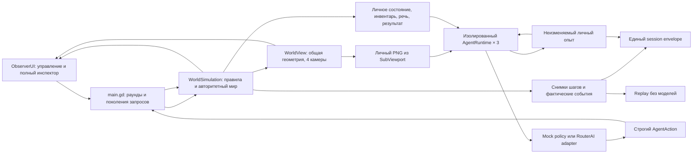

# Архитектура первого прототипа (исторический отчёт)

15 ноября 2026. Один процесс Godot 4.7.2, GDScript. Логический шаг не зависит от FPS; частота отрисовки не меняет состояние мира.

| Компонент | Файл | Граница ответственности |
| --- | --- | --- |
| World Simulation / Game Rules | `scripts/simulation/world_simulation.gd` | Позиции, время, столкновения, руки/ноги/зрение, владение, слышимость, валидация, детерминированный порядок конфликтов |
| Agent Runtime | `scripts/ai/agent_runtime.gd` | Изолированные решения, строгая схема, отмена, поколения, лимиты запросов |
| Real adapter | `scripts/ai/router_adapter.gd` | Отдельные HTTPRequest, timeout, обработка JSON, usage и версия модели; по умолчанию сеть отключена |
| Personal Memory | `scripts/ai/personal_memory.gd` | Копии личного опыта и PNG; контракт отдельного агента памяти без готовой суммаризации |
| Perception / world | `scripts/world/world_view.gd` | Общий World3D, индивидуальные SubViewport, полные стены в кадрах персонажей, отдельные observer layers |
| Observer UI | `scripts/ui/observer_ui.gd` | Управление и полная информация наблюдателя; его чтение не создаёт опыт персонажей |
| Composition / persistence | `scripts/main.gd` | Зафиксировать → наблюдать → собрать → проверить → применить → записать; единый проверяемый session archive, воспроизведение истории |

Runtime не хранит ссылку на симуляцию. Его prompt строится новым allowlist-объектом: собственный профиль, тело/потребности, личный инвентарь, услышанное, результат своих действий и собственная история. Полное состояние, чужие профили/инвентари, глобальные IDs, координаты и debug-накладки в prompt не передаются. Изображения поступают только из личных камер. Отдельная диагностическая геометрическая `mock_view` помогает Mock AI и исключается из VLM payload и памяти.

У действий `take/give` нет глобальных целей: правила разрешают ближайшую видимую доступную цель по взгляду и повторно проверяют её состояние в момент исполнения. Ответ модели — только намерение. Порядок доступа к последнему предмету зависит от номера шага и стабильного списка персонажей, а не от задержки сети.

Сохранение содержит проверяемый world archive и личные состояния в одном envelope. Перед загрузкой строятся временные компоненты; повреждённые данные не заменяют живой мир. Проверяются тела, позиции, владение, история шагов и соответствие текущего мира последней записи. Новые поколения блокируют старые ответы после pause/reset/load.

Replay читает сохранённые переходы, не запускает AI и не изменяет текущий мир. Точные пиксели рендера между GPU/драйверами не обещаются: исходные кадры сохраняются отдельно. Полные снимки и повторённые event lists рассчитаны на короткие отладочные сессии; потоковый формат журнала — следующий технический этап.
