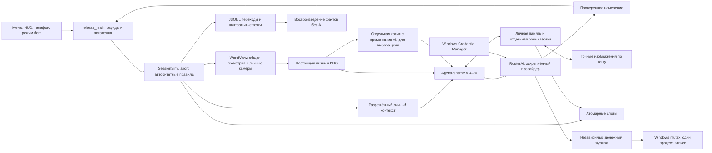

# Архитектура AI Sims 0.2

Один процесс Godot 4.7.2, GDScript, Windows x64, OpenGL Compatibility. Время и правила мира отделены от renderer и сетевых задержек. Историческая схема первого среза: [ARCHITECTURE_PROTOTYPE](ARCHITECTURE_PROTOTYPE.md).

| Компонент | Исходник | Ответственность |
| --- | --- | --- |
| Композиция | `scripts/release_main.gd` | Пауза, границы решений, сбор запросов, снимки, поколения, интеграция |
| Мир | `scripts/game/session_simulation.gd` | Тело, потребности, предметы, действия, конфликты, цели, вмешательства |
| Пространство | `scripts/game/spatial_rules.gd`, `map_catalog.gd`, `map_layouts.gd` | Три карты, видимость, изученное пространство, столкновения, маршруты |
| Общество | `scripts/game/economy_rules.gd`, `network_rules.gd`, `artifact_rules.gd` | Ресурсы, сделки, права, сообщения, устройства, фотографии, дневники |
| AI | `scripts/release_ai/agent_runtime.gd`, `router_adapter.gd`, `provider_catalog.gd` | Личные решения, JSON-схема, HTTP, проверка маршрута и тарифа, квитанции |
| Память | `personal_memory.gd`, `memory_agent.gd`, `media_archive.gd` в `scripts/release_ai/` | Защищённый свежий опыт, субъективные слои, доступ к точным снимкам |
| Расходы | `scripts/release_ai/usage_ledger.gd` | Резервирование, подтверждённые/неизвестные списания, монотонное восстановление |
| Хранилище | `scripts/release_storage/session_repository.gd` | Дельты, контрольные точки, атомарные слоты, backup |
| Windows helper | `credential_store.gd`, `tools/CredentialBridge.cs` | Анонимные каналы, Credential Manager, mutex денежного журнала |
| Представление | `scripts/release_world/` | Текстурированный мир, скелетные анимации, камеры, изолированный предпросмотр |
| Интерфейс | `scripts/release_ui/observer_ui.gd` | RU/EN, обычные формы; команды проходят авторитетные правила |

## Раунд и знания

Граница решений фиксирует мир. Для каждого свободного, живого и бодрствующего персонажа собираются собственный кадр и разрешённое наблюдение. Одновременно выполняются до четырёх запросов; отдельная роль памяти использует тот же лимит. Пока собираются решения, логическое время не продвигается. Затем намерения разрешаются в стабильном вращающемся порядке, выполняется шаг, записываются факты и обновляется представление. Продолжительные действия хранят план и исполняются между решениями.

Runtime не получает ссылку на мир. Запрос строится по белому списку: собственный профиль, тело, потребности, инвентарь, личные контакты, слышимая речь, доступные результаты и память. Нет полного состояния, чужих мыслей/инвентаря, глобальных ID и абсолютной карты. `mock_view` предназначен для обозначенной офлайн-политики и исключён из реальных запросов и памяти. Временные визуальные ссылки связывают объекты с UV текущего кадра; цель фиксируется при приёме намерения и снова проверяется при исполнении.

Контекст экрана требует явного использования/чтения устройства. Вложение или показ фотографии создаёт личный доступ к точному изображению; одного существования файла в архиве недостаточно. Хеш проверяется по содержимому. Администратор может менять доставляемую версию сообщения, но не прочитанный опыт получателя. Наблюдатель видит исходный след и вмешательства отдельно.

Для точного выбора объектов runtime может получать дополнительную копию текущего кадра с уже разрешёнными временными `vN` в их UV-позициях. Эти искусственные метки явно отделены от физических объектов: они не добавляют названий, типов или скрытых целей, не попадают в фотографии, память и сохранения. Исходный PNG сохраняется точным. Подлинность источника вспомогательного кадра связывается SHA256 и размером, а отдельные пиксельные проверки подтверждают неизменность оригинала.

## Память и восстановление

Свежий игровой час хранится неизменяемыми личными записями. Отдельная роль памяти получает более старый личный опыт, сворачивает его в субъективные эпизоды и семантику. Эпизодические изображения теряют личную доступность после семи дней, даже если провайдер свёртки недоступен. Возможности пересмотра вторичных черт назначаются на 1–60 дней со средним 30; фундамент недоступен для изменения AI. Явные вмешательства наблюдателя имеют отдельный след.

Слоты содержат мир, личные runtime и планировщик. До замены живых компонентов проверяются вложенные части. Денежный журнал и ключ в игровые слоты не входят. Ключ передаётся помощнику через анонимный канал; исполняемый файл проверяется и размещается под именем с хешем версии. На денежный журнал удерживается Windows mutex; второе окно получает явную блокировку платных запросов. После аварии незавершённые списания остаются неопределёнными и не пополняют бюджет.

Мировой журнал хранит дельты и события, полную контрольную точку — раз в пять игровых минут. Выполненный переход записывается до ожидания renderer для фотографии; привязка PNG дописывается отдельно. Пропущенные, переставленные или обрезанные записи отклоняются. Replay проверяет восстановленный мир и не вызывает модели; текущий мир продолжения не изменяется. Пиксельная идентичность повторного рендера между GPU не обещается: исходные личные кадры хранятся отдельно.

## Доставка

Сборка копирует разрешённые runtime и ресурсы в чистый каталог, импортирует его и экспортирует EXE/PCK. Проверка разбирает PCK, проверяет ссылки на ресурсы, helper, лицензии, контрольные суммы и запускает распакованный EXE. Тесты, кэш загрузок, ключи и пользовательские сохранения в архив не попадают. CI собирает артефакт вручную; отдельный релиз автоматически не публикуется.
