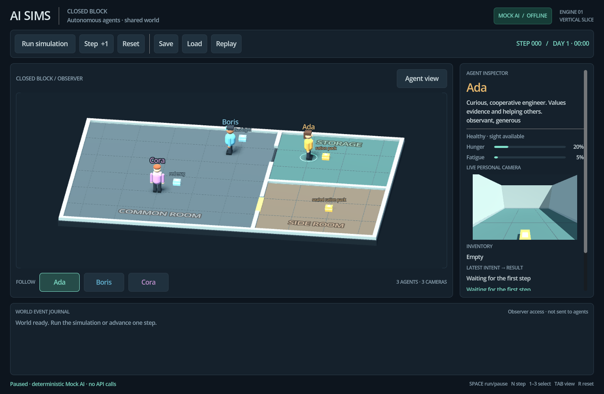
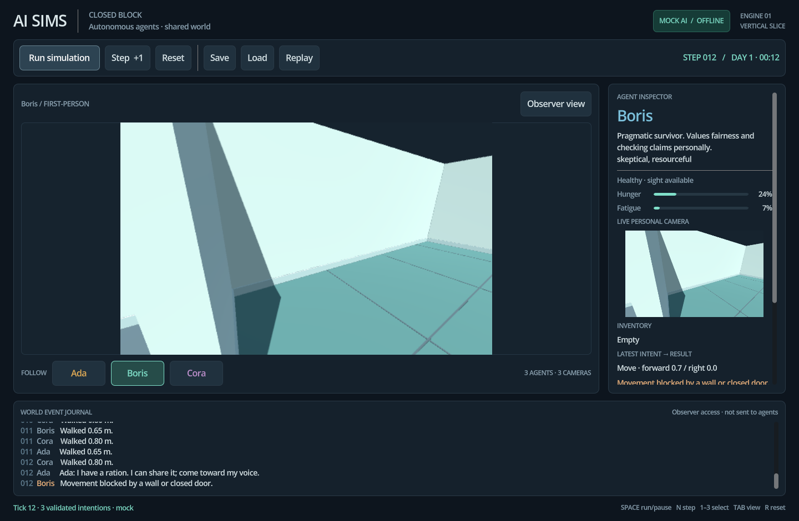

# Отчёт QA первого спринта

15 ноября 2026. Реальный запуск: Godot **4.7.2.stable.official.ed1daf0bf**, Windows, OpenGL 3.3 Compatibility, NVIDIA GeForce RTX 4080 SUPER. Платных вызовов: **0**. Исследования поведения LLM не проводились.

## Выполненные проверки

```powershell
.\tools\run.ps1 -Tests
.\tools\run.ps1 -Smoke
```

Headless runner объединяет Simulation, Runtime, 40-раундовый end-to-end Mock episode и отдельный набор независимого QA. Все возвращают 0 failures. Render smoke запускает настоящую сцену и сохраняет изображения/JSON; headless вместо renderer он отклоняет.

| Требование | Результат и доказательство |
| --- | --- |
| Godot запускается без критических ошибок | PASS: editor import, полная сцена headless, настоящий GPU-запуск |
| Три тела в допустимых позициях и движение | PASS: swept collision, стены/дверь, другие тела, границы пола, 40 раундов, проверка допустимости поз в save |
| Разные реальные изображения камер | PASS: три непустых PNG 512×320 с разными hash |
| Предмет за стеной отсутствует в кадре | PASS: удаление скрытого пайка даёт идентичные пиксели личного кадра; удаление видимого меняет кадр |
| Последний экземпляр не дублируется | PASS: конфликт двух take, разные фазы приоритета и порядок прихода словаря; ровно один держатель |
| Reset не принимает старые ответы | PASS: pending capture, runtime generation, отменённые/дублированные/неверного tick callbacks, root collector |
| Невалидный ответ не ломает симуляцию | PASS: неизвестные поля/команды, неверные типы/числа/JSON/provider wrapper, timeout/error fallback wait |
| Пауза останавливает логику | PASS: реальный Run/Pause принимает mouse events; время не продвигается; pending automatic round отменяется |
| Replay восстанавливает последовательность без модели | PASS: каждый промежуточный snapshot совпадает; UI начинает с tick0 и проигрывает историю без изменения живого мира |
| Observer не раскрывает тайны персонажам | PASS: secret sentinels в чужих мыслях/инвентаре и скрытом предмете не меняют prompt; overlay/selection не меняют пиксели |
| Личная память и состояние сохраняются | PASS: save/load восстанавливает tick и память; ошибки вложенных данных не стирают прежнюю историю и не загружают мир частично |
| Телесные ограничения | PASS: руки, зрение, замедление/расход, ползание; в renderer низкая камера и лежащая поза согласованы |

Финальные размеры наборов и renderer приведены в `screenshots/render_report.json` и выводе runner. На момент финальной проверки: Simulation **117**, Runtime **155**, независимый QA **35** проверок; интеграционный эпизод **40** раундов; визуальный smoke **29** проверок. Итог — 0 failures, без script/runtime errors в финальном запуске.

## Найдено и исправлено

| Причина | Исправление и регрессия |
| --- | --- |
| `%g` не поддерживается GDScript formatter, поворот создавал engine error | Поддерживаемый формат; последовательный эпизод с поворотами проходит без ошибок |
| JSON нормализует типы чисел, прямое сравнение сериализованных строк давало ложный save mismatch | Сравнение нормализованных значений и проверка восстановленных полей |
| Frozen target мог уже отойти перед исполнением give | Повторная live-проверка дистанции/видимости/возможностей; тест recipient moves away |
| Повреждённый save мог расходиться с концом журнала или переписывать прошлые события | Валидация endpoint, append-only history и inbox; corruption tests |
| Корректная по форме загрузка могла поместить тело внутрь стены | Проверка радиуса тела, двери, пола и соседей во всех snapshot; отдельный независимый repro |
| Импорт личной памяти начинался с reset и принимал неверные вложенные типы | Полная typed-валидация во временном MemoryStore, замена только после успеха; история/поколение/budget не теряются |
| Раздельные world/sidecar файлы могли рассогласоваться | Единый session envelope, hash world archive, временная проверка всех runtime до замены мира |
| Старый capture мог завершиться после reset/pause | Lifecycle generation в composition root + generation/cancel в runtime; тесты обоих уровней |
| Выбор личной текстуры перекрывал observer view; программный выбор не синхронизировал inspector | UI отвечает за центральную текстуру, отдельные методы синхронизируют выбранного персонажа/вид |
| Мировая сцена занимала слишком мало центральной панели | Скорректированы aspect ratio/orthographic framing, новый скриншот проверен визуально |
| При ползании оставалась стоящая модель | Отдельная группа appearance принимает низкую позу вместе с низкой камерой |
| Provider usage терялся по пути в trace | Токены/стоимость и requested/returned model сохраняются в diagnostics |

Независимый QA писал собственные проверки и возвращал конкретные случаи авторам компонентов. После исправлений главный агент повторно запустил всю сборку и настоящий renderer.

## Не проверено / не реализовано

Реальные платные ответы RouterAI, качество VLM, цена/latency, субъективное сокращение памяти, терминал/очередь, сетевые вмешательства, долгие сессии, standalone export и другие платформы. Эти пункты не выдаются за пройденные. Подробные ограничения — в [ENGINE_STATUS.md](ENGINE_STATUS.md).




