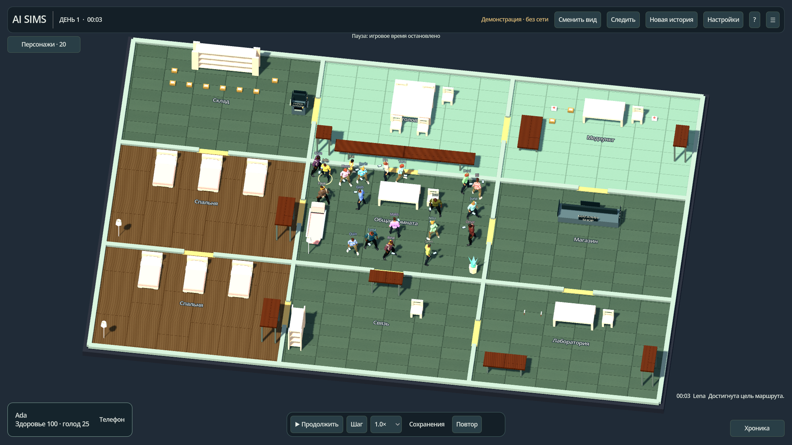
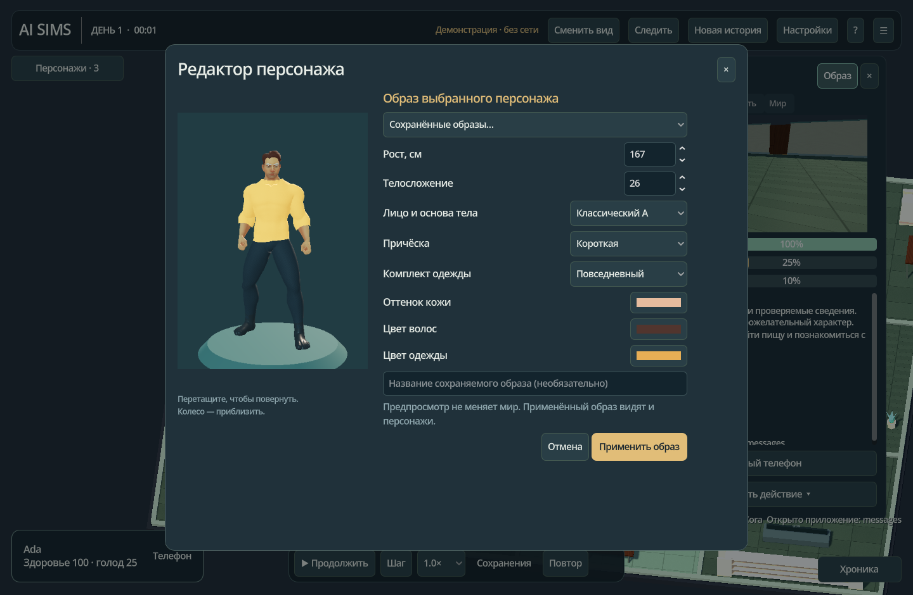

# Проверка AI Sims 0.3.0-beta.1

17 ноября 2026. В браузере проверяются непосредственно собранные файлы игры. Демо-тесты используют входные события и автономные политики. Платный прогон использует нативный Godot, тот же планировщик, RouterAI и изображения индивидуальных камер. [Сводка текущих прогонов](acceptance/beta-checks.json) · [Первое прохождение владельца](BETA_TEST.md).

## Архив проверки Windows 0.2

15 ноября 2026. Проверяется release-сцена `scenes/release.tscn`, а не прежний трёхперсонажный прототип. Его неизменённый отчёт сохранён в [QA_PROTOTYPE.md](QA_PROTOTYPE.md). Все приведённые изображения получены настоящим Godot renderer.

Среда: Windows, Godot **4.7.2.stable.official.ed1daf0bf**, OpenGL Compatibility, **RTX 4080 SUPER**, Intel Core i7-14700KF, 64 ГиБ RAM. Независимые QA-наборы не выполняют платных запросов и не читают пользовательский ключ. Их сохранения, денежные журналы и сессии изолированы. Отдельную разрешённую приёмку RouterAI выполняет главный агент; она описана отдельно ниже.

## Подтверждённые проверки

| Набор | Результат | Что проверено |
| --- | --- | --- |
| Release Simulation | **317 / 317 PASS** | Правила мира, тела, бой, лечение, навигация, ресурсы, устройства, сетевые приложения и валидация состояния |
| Release AI | **409 / 409 PASS** | Строгие намерения, изоляция личных знаний, изображения с подтверждённым доступом, память, отмена поколений, стоимость, общий лимит и блокировка журнала |
| Release Integration | **27 535 проверок, 0 failures** | По 80 последовательных шагов на трёх картах с 20 runtime; диапазоны состояния, движение, единственность владения вещами и восстановление |
| Независимый adversarial QA | **88 / 88 PASS** | Связанные сценарии боя, очереди, экономики, чтения/подмены сообщений, фото, помощи телу и повреждённых сохранений |
| Storage | **15 / 15 PASS**, проверено главным агентом | Atomic save/backup, промежуточные replay-переходы, отклонение пропусков и обрезанного журнала; отдельный изолированный credential self-test |
| Реальные элементы интерфейса | **84 / 84 PASS** | Mouse input через действующие меню и PopupPanel, выполнение команд в авторитетном мире, настройки RU/EN и защита асинхронного шага |
| Настоящий renderer | **113 / 113 PASS** | 108 пиксельных проверок трёх карт по 20 камер, включая физические вывески за стеной, и 5 проверок действительного 1080p/offline benchmark |
| Worker PNG | **9 / 9 PASS** | Точные native PNG/RGBA bytes, отдельная копия изображения, завершение после удаления caller и освобождение задачи |
| Target-badges | **10 / 10 PASS** | Исходный кадр и observer не меняются, изменения только внутри значков vN; валидация, лимит 64, защита concurrent/reset |
| Настоящий Main collector | **14 / 14 PASS** | Fixture без HTTP: два текущих PNG, source hash, точные UV/ссылки, сохранность ссылок через await и исполнение правильного terminal-ref |
| Phone/photo UI → rules | **27 / 27 PASS** | Реальные состояния сообщений/групп/форума/голосований/доски; выбор раннего цифрового фото и корректного вложения, исключение закрытой камеры |
| Сутки логической симуляции | **156 / 156 PASS** | По 24 **игровых**, а не реальных часа на каждой карте, 20 агентов; ограниченная память, валидные состояния, доставка всех личных событий и replay |
| Самостоятельное питание demo | **3 / 3 PASS** | За игровые сутки реальные consume через production rules: 30 / 23 / 26; конечные запасы действительно уменьшаются |

Число проверок integration зависит от фактических намерений политики; здесь указан результат конкретного выполненного запуска. Его журнал — `test-output/release-ui-qa/units.log`.

Сохранённые переносимые доказательства: [unit output](screenshots/release_units.txt), [renderer/benchmark JSON](screenshots/release_render_report.json), [UI JSON](screenshots/release_ui_report.json), [сутки и память](screenshots/release_soak_report.json), [питание demo](screenshots/release_gameplay_report.json). Абсолютные пути временного user-каталога из копии soak-отчёта удалены; численные результаты сохранены.

### Игровые сценарии

- Обычный успешный удар ножом снимает 20 из 100 здоровья. Пять ударов по бодрствующему противнику приводят к смерти; мгновенное убийство разрешается только спящему или бессознательному. Повреждения рук проверяются повторно при исполнении действия.
- Последний паёк не дублируется; лимит выдачи и очередь сохраняются. Две очереди оборудования не выдают одному человеку два взаимоисключающих займа.
- Доставка сообщения не означает его прочтение. Прочитанное становится личным опытом; поздняя подмена не переписывает уже пережитый текст. Серверная исходная версия и редакции доступны наблюдателю.
- Форум, ответы, голосование и полный выигрышный ход крестиков-ноликов проверяются связанными действиями движка. Права устройства, личные контакты и серверные ссылки не заменяются знанием глобальных ID.
- Фото создаёт настоящий запрос захвата; main сохраняет PNG с позой именно этого шага. Пауза во время `frame_post_draw` не оставляет пустой окончательный снимок и не теряет уже совершённый шаг журнала.
- Правка цели и фундамента через обычное намерение/режим бога синхронизирует авторитетный профиль и следующий контекст runtime. Явная замена памяти очищает историю только по соответствующей команде.
- Загрузка сначала валидирует мир, всю личную память и расписание решений. Повреждённый `next_decision` не загружает мир частично. Старое поколение AI не меняет новую сессию.

### Интерфейс проверен через ввод

Проверены реальные нажатия: главное меню, Continue/Pause, Step, карточка персонажа, Appearance и Apply, вид камеры и Follow, God Apply, Save/Load в выпадающем меню, выбор приложения телефона → Open → создание темы, новая карта с 20 персонажами, Replay, Settings → язык/качество/скорость/звук. Проверки сравнивают состояние движка и действительные текстуры, а не только наличие `command.emit`.

Отдельная проверка заполняет все четыре общих слота запросами роли памяти: время и состояние мира остаются неизменными, ожидающее решение автоматически запускается после освобождения слотов и применяется один раз. Сеть заменена явно обозначенной fixture, платных вызовов нет.

При истекающем тарифе бесплатный preflight откладывается до освобождения **всех** общих запросов: освобождение только одного из четырёх слотов его не запускает. FakeCatalog фиксирует ровно один вызов с минимальной требуемой валидностью 420 с; нет HTTP, платного reservation или изменения игрового времени. Инвалидация поколения отменяет отложенный preflight.

Чтение настоящего экрана телефона немедленно пополняет личную память, даже когда следующее решение отложено на 1000 игровых минут; текущие визуальные ссылки не сбрасываются, запрос модели не создаётся. После явной очистки памяти удалены и короткие уведомления движка: следующий осмотр не воскрешает прочитанное. Завершение worker-PNG от предыдущей сессии не прикрепляет снимок к новому миру с теми же ID людей.

Отдельный 27-проверочный phone-flow проверяет привязку UI-команд к состояниям правил, включая выбор `{slot,index}` и точную идентичность вложения. Для выбора фотографий в нём используются явно обозначенные hash-fixtures, без изготовленных изображений; настоящие PNG и доступ к пикселям проверяются другими наборами. Этот набор не выдаётся за 27 физических mouse-сценариев.

### Пиксельная приватность

Для каждой release-карты созданы 20 настоящих изображений 640×360 с 20 различными hash. После обхода постоянно обновляется только выбранная личная камера.

Контрольные пары используют физическую стену текущей карты и неподвижную сцену: удаление предмета прямо за стеной меняет **0 пикселей**, удаление видимого предмета меняет кадр. Большой observer-only объект действительно виден в observer-кадре, исключён из личного и появляется в нём только в отрицательном контроле при намеренном включении его слоя. Смена выбранного персонажа не меняет его личные пиксели.

У персонажа максимального проверяемого роста 1.2 паёк на полу в 1.05 м присутствует в настоящем PNG и остаётся в доступных UV-targets; возвращённая ссылка выполняет настоящее `take`. Эта проверка выявила недостаточный наклон камеры и затем зависимость видимости своего телефона от выбора наблюдателя; обе причины исправлены и регрессии проходят.

Физические надписи `ПАЙКИ / RATIONS` и `МАГАЗИН / SHOP` принадлежат предметам, проходят обычный depth test и не содержат скрытых остатков или reference ID. Удаление целого терминала за стеной тоже меняет 0 личных пикселей.

Для real VLM передаётся явно обозначенная вспомогательная копия текущего вида с небольшими искусственными значками `vN`. Это средство выбора действия; оно не является фотографией, мировой надписью или личной визуальной памятью. Проверка 10 случаев подтверждает неизменность исходного CPU-кадра, личного viewport и observer; за пределами прямоугольников значков нет изменённых пикселей. Разрешены только корректные временные ссылки и конечные UV, максимум 64 значка; устаревшие результаты concurrent/reset отбрасываются.

Независимый Main-fixture использует production collector и один локальный ответ `look`, без HTTP/ключа. Два исходящих изображения содержат сырой кадр и helper; `grounding_source_hash` соответствует точным исходным PNG bytes. Все UV совпадают с реальной камерой и текущей картой ссылок, которая не меняется во время render/encoding await. В конкретной позе terminal — `v0` с UV примерно `(0.5,0.499)`, door — `v1`; применение terminal-ref вызывает правила терминала. [Отчёт](screenshots/release_binding_report.json), [сырой кадр](screenshots/release_binding_original.png), [helper](screenshots/release_binding_helper.png). Observer-only мировые ID диагностического отчёта не входят в payload модели.

## Сутки симуляции и demo

Интервал решений — 5 игровых минут, 288 шагов на карту. Это ускоренная проверка логики; она **не является 24-часовым wall-clock soak**. Нет сетевых запросов, вмешательств для спасения агентов или добавления запасов в ходе сценария.

Итоговый прогон включает тот же синхронный канал личных событий, что и main: **3516 / 1296 / 1402 событий доставлено, 0 потеряно или отклонено**. Максимумы недавних записей: 32 / 27 / 25; очереди свёртки: 5 / 4 / 4; эпизодов — 92, версий — 32, observer-tail — 500. Защищённое недавнее окно не превышает часа. Максимальный export одного runtime — 0.66–0.73 МБ.

Transition-журналы: 14.2 / 11.3 / 11.5 МБ. Полные сессии с 289 checkpoint каждая занимают около 154 / 175 / 169 МБ, без PNG-архива. Их размер растёт со временем; утверждается линейное хранение истории и ограниченность рабочих слоёв памяти, а не постоянный общий объём диска. Все почасовые состояния импортируются, личные истории восстанавливаются, фундамент сохраняется, последний мир реконструируется с нормализацией JSON-чисел. Прогон занял 166.6 с реального времени.

Первая demo-политика ходила по ограниченному циклу и не ела, несмотря на доступные запасы: 0 consume на всех картах. Независимая регрессия сохранена отдельно от инвариантов. После исправления исследования помещений, прохода дверей, памяти увиденных направлений и порога досягаемости итоговый независимый прогон дал:

| Карта | Consume | Выдано пайков терминалом | Живы к концу | Магазин: пайки в конце |
| --- | ---: | ---: | ---: | ---: |
| Closed Block | 30 | 0 | 19 / 20 | 10 из начальных 40 |
| Residence | 23 | 5 | 19 / 20 | 30 из начальных 40 |
| Research Station | 26 | 6 | 19 / 20 | 28 из начальных 40 |

Выживание всех персонажей не утверждается. Эти результаты подтверждают самостоятельное использование существующей еды через правила, а не качество поведения реальной модели.

## Производительность

Настоящий viewport и observer render target — **1920×1080**, medium, 20 агентов, VSync выключен, `Engine.max_fps=0`. По 2.5 с прогрева и 8 с измерения на режим/карту. В фоне работала отдельная платная приёмка; короткий UI-повтор пересёкся с началом измерения. Это измерение с конкуренцией за ресурсы, а не изолированный аппаратный benchmark. В итоговом коде lossless PNG кодируется worker-потоком, GPU readback остаётся в основном потоке.

| Карта | Пауза, анимации включены: средний FPS | Demo работает: средний FPS | Demo p95 кадра | Demo p99 кадра |
| --- | ---: | ---: | ---: | ---: |
| Closed Block | 258 | 232 | 8.85 мс | 16.50 мс |
| Residence | 257 | 215 | 10.04 мс | 21.20 мс |
| Research Station | 253 | 216 | 9.10 мс | 19.78 мс |

До worker-PNG сбор восприятия давал p95 около 60–65 мс; этот источник регулярных задержек исправлен. В более раннем worker-прогоне p95 составлял 5.1–5.7 мс; в последнем прогоне с физическими вывесками и текущей фоновой нагрузкой приведены значения таблицы. Доля кадров длиннее 16.67 мс — 0.75 / 3.20 / 1.62%. **GTX 1650, 16 ГБ RAM и целевые 1080p60 на минимальной машине не проверены.** Нельзя переносить результат RTX 4080 SUPER на минимальную конфигурацию или длительные сессии.

## Реальная RouterAI-приёмка

Выполняется главным агентом отдельно от независимых offline-наборов. Безопасный текущий отчёт: `test-output/live/release_acceptance.json`; это данные настоящих VLM-вызовов с pinned provider `byteplus` и общим монотонным лимитом 1000 ₽. Ключ не находится в отчётах, исходниках и экспортируемых сохранениях.

Длинный базовый прогон завершён: **3619.094 с реального времени**, три последовательные карты по 20 агентов и примерно 20 реальных минут каждая, **2001 зарегистрированный runtime-вызов**, 0 итоговых harness failures и 0 HTTP-сбоев провайдера. Сохранён [неизменённый raw v1](screenshots/release_live_v1.json). На последней карте зарегистрирована одна управляемая локальная пауза из-за истечения тарифа; она не скрыта и не считается HTTP-ошибкой провайдера.

| Карта | Реальные секунды | Игровые минуты | Вызовы | Переместились | Save / journal tick |
| --- | ---: | ---: | ---: | ---: | --- |
| Closed Block | 1209.20 | 38.2 | 673 | 18 / 20 | PASS / PASS |
| Residence | 1202.64 | 40.2 | 655 | 20 / 20 | PASS / PASS |
| Research Station | 1202.12 | 41.2 | 673 | 20 / 20 | PASS / PASS |

На конец v1 общий денежный журнал, включая предшествующий короткий smoke, показывает **466.850412 ₽ подтверждённого расхода**, **21.170775 ₽ неопределённой стоимости** прерванных запросов, 0 активного резерва. Неопределённая сумма не обнулена и консервативно уменьшает остаток: суммарно учтено **488.021187 ₽ из 1000 ₽**. Это состояние на конкретный момент, до следующих разрешённых проверок.

Локальная tariff-expiry пауза отменила другие незавершённые запросы и дала указанную неопределённую сумму. В текущем коде quote обновляется с запасом валидности 420 с и только после завершения всех активных запросов/receipts; независимая Main-регрессия очереди входит в 84 UI checks.

Базовый процесс загрузил классы **до последних исправлений** навигации, камеры, памяти, PNG-worker и бюджетной блокировки. Он подтверждает длительную работу реального VLM и игровых переходов, но не доказывает поздние изменения. Целевые capability-cases и короткий текущий live-повтор остаются отдельной проверкой.

В raw v1 поле `network_time_is_frozen=false` получено ошибочным монитором: редкий таймер сравнивал время через границы двух разных раундов. Исправленный монитор сравнивает текущий мир с минутой наблюдения своего pending-round. Независимая управляемая регрессия и текущий короткий live-повтор проходят. Raw v1 сохранён отдельно и не исправлен задним числом.

### Реальные цели на текущем коде

Финальная целевая приёмка **V5: 9 / 9 PASS**, 16 настоящих запросов, 100.502 с, `network_time_is_frozen=true`. [Полный безопасный отчёт](acceptance/live-capabilities-final.json).

| Цель | Реальные запросы | Результат |
| --- | ---: | --- |
| Увидеть → подойти → взять → съесть приготовленный паёк | 4 | PASS, употреблён именно показанный предмет |
| Сообщить личное наблюдение вслух свидетелю | 1 | PASS, реальный слуховой опыт свидетеля |
| Сделать настоящий цифровой снимок | 1 | PASS, прикреплён PNG |
| Рассмотреть доступный снимок прошлого | 2 | PASS, личный опыт просмотра |
| Отправить личное сообщение | 2 | PASS, сообщение в авторитетном состоянии |
| Прочитать полученное сообщение | 2 | PASS, личный опыт чтения |
| Прочитать изменённое извещение | 2 | PASS |
| Лично проверить извещение у терминала | 1 | PASS, `read_terminal` и соответствующая objective |
| Отдельная реальная роль памяти | 1 | PASS, новая subjective revision, свежая запись и фундамент сохранены |

Это **подготовленные goal-following fixtures с тремя персонажами**, а не заявление, что все перечисленные события сами возникли в свободном sandbox. Положение, голод, знакомства и цели заданы явно; намерения и последующие действия получены от настоящей модели. Для memory-case игровые часы явно продвинуты на 65 минут без модельных действий, чтобы состарить уже накопленный личный опыт. Свежая запись после этого сохранена без изменений.

Неуспешные V1–V4 сохранены неизменёнными в `docs/acceptance/`: ранняя модель повторяла подход вместо взаимодействия, использовала display name вместо scoped contact-ref и не завершала terminal-case. После уточнения API-последовательности, временных ссылок, физической идентификации устройства и семантики `request_ration` финальный набор завершён. Реальный `request_ration` читает правила доступного терминала в пределах 2 м и не требует target-ref. Проваленные попытки не выданы за прохождение.

### Короткий повтор всех карт на текущем исходном коде

[Текущий raw report](acceptance/live-current.json): **242.217 с**, три карты по 20 агентов, 0 ошибок и итоговых failures; на каждой карте `network_time_is_frozen`, `save_loadable`, `journal_restores_tick` — **true**. Включено завершение запросов после контрольного интервала.

| Карта | Реальные секунды | Игровые минуты | Переместились | Raw calls до drain |
| --- | ---: | ---: | ---: | ---: |
| Closed Block | 75.43 | 1.0 | 0 / 20 | 36 |
| Residence | 81.17 | 1.0 | 1 / 20 | 34 |
| Research Station | 81.91 | 1.0 | 7 / 20 | 32 |

`maps[].calls` собрано до завершения последних запросов, поэтому сумма 102 не является итоговым числом. Из общего журнала: `2253 − 2135 = 118` запросов за текущий повтор. Raw поля не переписаны. Короткий тест подтверждает lifecycle/save/заморозку последнего кода; он не подменяет длительный V1 или целевые сценарии V5.

**Окончательный общий денежный журнал всех приёмочных попыток:** 480.060143 ₽ подтверждено, 21.170775 ₽ остаётся неопределённым только от старой tariff-expiry паузы, 0 активного резерва и запросов. Итого консервативно учтено **501.230918 ₽ из 1000 ₽**, остаток 498.769082 ₽. Текущий повтор не увеличил unknown cost.

## Экспортированный Windows EXE

Главный агент запустил EXE из проверенной распаковки с `--test-profile` на этой же Windows-машине: подтверждены путь работающего приложения, настоящее главное меню и открытие модального диалога новой истории нажатием его кнопки. Пользователь нажал Escape для остановки computer-use; нативный ввод прекращён, окно старого тестового кандидата оставлено под управлением пользователя и больше не трогалось. Полный нативный сценарий save/load/телефона/режима бога не заявляется.

Source UI driver прошёл 84 проверки в исходном проекте. Release EXE не исполнил внешний driver через `--script`, поэтому его прохождение **не** приписывается архиву. Нативный smoke относится к кандидату сборки на момент проверки; последующие небольшие source-исправления не проверялись повторным нативным вводом. Проверка PCK/компилированных ресурсов и нативный старт — отдельные доказательства. Чистая Windows-машина и полное нативное прохождение пока не проверены.

Финальный `build/AI-Sims-Windows-x64.zip` размером 57 844 171 байт прошёл default offline build/pack verification. Главный агент сравнил восемь ключевых runtime-файлов со снимком `build/release-source/`: Main с SOM/preflight420/изолированными preset, World с grounding/signage, AI409, Core317, UI и PNG-worker совпадают с протестированным кодом. Сборка сделана из рабочего среза (`source_dirty=true`); fingerprint и file hashes фиксируют его фактическое содержимое. Полные checksum, команды и границы проверки — в [RELEASE_BUILD.md](RELEASE_BUILD.md).

## Обнаруженные и закрытые причины

| Причина | Исправление / подтверждение |
| --- | --- |
| CLI `--auto-run` отменялся последующим разбором карты/числа агентов | Сначала собираются все параметры, запуск выполняется последним; настоящий startup-тест проходит |
| Обычный `set_goal` оставлял старую цель в runtime | Успешное событие синхронизирует текущий профиль; проверены обе стороны |
| Пауза во время сохранения фото теряла уже совершённый шаг | Журнал фиксирует шаг до ожидания GPU, завершение привязано к run_id |
| Четыре memory-запроса могли навсегда остановить очередь решений | Main возобновляет dispatch при освобождении общей ёмкости |
| Недостаточно глубокая валидация save/runtime/scheduler | Вложенные типы проверяются до замены состояния; malformed fixtures не меняют живой мир |
| Replay мог молча пропустить отсутствующую или обрезанную запись | Проверка последовательности и достижения целевого перехода; 15 storage checks главного агента |
| Упрощённый demo-цикл не находил еду | Самостоятельное исследование, подход/проход дверей, личное направление к замеченным ресурсам, согласованный reach 1.5 м |
| Камера теряла доступную еду у ног высокого персонажа | Pitch −24°, настоящий PNG/UV/take на расстоянии 1.05 м |
| Видимость своего телефона зависела от выбора наблюдателя | Held-item слои синхронизируются с selected/capture body; пиксельная инвариантность на трёх картах |
| Новое HUD скрывало управление видом в старой неиспользуемой панели | Видимые RU/EN кнопки Switch view и Follow; настоящие input-regressions |
| Импортированные суффиксы `Hair_N_001` оставляли несколько причёсок | Исправлен разбор; ровно одна выбранная Hair_3 в preview и в мире |
| Lossless PNG кодировался синхронно в render/game потоке | Изолированный worker, generation/run check после await; точные bytes и отмена/reset проверены, регулярные 60 мс пики устранены |

## Остающиеся границы доказательств

- Длинный v1, целевые реальные сценарии V5 и текущий короткий повтор завершены. Все 24-часовые проверки здесь относятся к игровому времени; реальный длительный прогон составляет около часа с последовательной сменой карт.
- Нужен прогон экспортированного пакета на чистой Windows и реальная минимальная GPU-конфигурация. На рабочей машине подтверждён нативный startup/new-story smoke кандидата; 84 автоматические UI-проверки относятся к исходному проекту.
- Не проведены 24 реальных часа непрерывной работы, длительные массовые сетевые сбои и полный проход всех вариантов authored objectives.
- Проверен основной английский интерфейс. Авторитетные тексты мировых событий/названий могут оставаться русскими; полная локализация контента не подтверждается.
- Каждая кнопка сообщений/групп/голосований/игровой доски не проходила отдельный независимый end-to-end UI сценарий. Их авторитетные механики покрыты связанными автоматическими тестами; реальный форумный UI проверен до изменения мира.

## Воспроизведение

Из корня репозитория, заменив `$godot` путём к Godot 4.7.2:

```powershell
& $godot --headless --path . --script res://tests/release_qa_runner.gd -- --all-novault
& $godot --headless --path . --script res://tests/release_qa_runner.gd -- --soak
& $godot --headless --path . --script res://tests/release_qa_runner.gd -- --gameplay
& $godot --path . --script res://tests/release_ui_qa.gd -- --test-profile --auto-run --agents=3 --map=residence
& $godot --path . --script res://tests/release_visual_qa.gd -- --test-profile
& $godot --path . --script res://tests/release_phone_flow.gd -- --test-profile
& $godot --headless --path . --script res://tests/png_encoder_qa.gd
& $godot --path . --script res://tests/release_grounding_qa.gd -- --test-profile
& $godot --path . --script res://tests/release_main_binding_qa.gd -- --test-profile
```

`--pixels-only` у visual QA повторяет пиксельные регрессии без нового benchmark. Headless renderer отклоняется визуальными наборами. Платный live-harness не входит в обычные команды тестов.

## Снимки версии 0.2





Другие исходные кадры: [Residence](screenshots/release_residence.png), [Research Station](screenshots/release_research_station.png), [личная камера](screenshots/release_first_person.png), [еда в 1.05 м у высокого персонажа](screenshots/release_tall_nearby_food.png).
